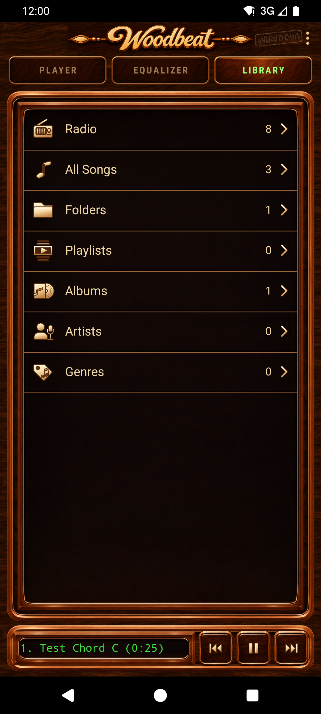

# WoodBeat

Android music player and internet radio with a hand-crafted wooden look, in the spirit of the classic desktop players — by **Aniruddha DuttaChowdhury**.

Version **0.1.0** (build 17). Package: `app.adc.woodbeat`. Android 8.0+ (phones and tablets).

[Download APK](https://github.com/aniruddhaKol/WoodBeat/releases/tag/v0.1.0)

## Screenshots

Captured on the Android emulator, 18 November 2026.

| Player | Playlist menu | Equalizer |
| --- | --- | --- |
|  |  |  |

| EQ presets | Library | Radio |
| --- | --- | --- |
|  |  |  |

## Features

- **Player:** seven-segment time (tap for remaining), scrolling title, kbps / kHz / mono-stereo, spectrum and oscilloscope (tap to switch), seek, volume, balance, shuffle, repeat (all / one).
- **Playlist:** add files, folders or stream URLs; remove, crop, select; sort, reverse, randomize; save and load lists.
- **Equalizer:** preamp + 10 bands (60 Hz – 16 kHz), response curve, built-in and custom presets, optional auto-load by genre.
- **Library:** radio, all songs, folders, playlists, albums, artists, genres.
- **Internet radio:** saved stations with a starter list of Indian Bengali stations, radio-browser.info search, Play URL.
- Background playback with notification, lock-screen and Bluetooth controls; opens audio files from file managers.

## Source layout

- `src/main/kotlin/app/adc/woodbeat/` — app code: `PlaybackService` (Media3), `WoodDsp` (EQ, balance and analyser as an ExoPlayer audio processor), pages and wooden widgets.
- `images/` — source artwork; `tools/make_assets.py` turns it into `src/main/res/drawable-nodpi/` (needs Pillow, numpy and Microsoft Edge for the SVG glyphs).
- `docs/screenshots/` — README screenshots.

## Build

Requires Android SDK platform 36, JDK 17 and Gradle 8.13. `build.ps1 -DebugBuild` builds a debug APK into `build/` (paths at the top of the script point to the local toolchain).

Third-party attribution is in [THIRD-PARTY-NOTICES.md](THIRD-PARTY-NOTICES.md). License: [PolyForm Noncommercial 1.0.0](LICENSE.md).
